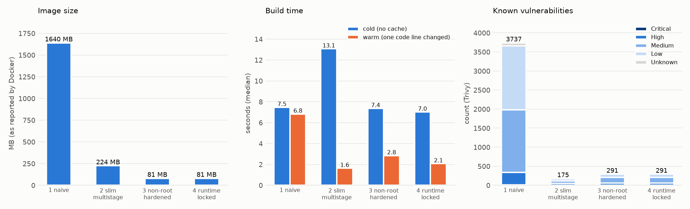

# 🐳 Docker Hardening Lab

One tiny Python service, built four ways, from the Dockerfile most tutorials end with to one you could put in front of a customer's security team. Every step is measured on a real Docker daemon: image size, layers, build time with and without a warm cache, what the container can do once it is running, and known vulnerabilities.

It is a small project on purpose. The point is the habit: change one thing, say what it buys, and measure it instead of asserting it.

This is original code. The service is about 60 lines of standard-library Python plus one signing library, and the same code runs in every stage.

## The four stages

| Stage | File | What changes, and why |
|---|---|---|
| 1. naive | `docker/01-naive.Dockerfile` | `python:latest`, root, `COPY . .` before `pip install`. Works, and is the baseline. Huge, floats on a tag, and every code edit reinstalls dependencies. |
| 2. slim, multi-stage | `docker/02-slim-multistage.Dockerfile` | Slim base, dependencies installed in a build stage and copied into a clean final stage, `--no-cache-dir`, requirements copied before source so the dependency layer is cached. Still root, still shell and pip in the image. |
| 3. non-root, hardened | `docker/03-nonroot-hardened.Dockerfile` | Base images pinned by tag **and** digest (recorded in `docker/base-images.json`). Distroless runtime: no shell, no package manager, no pip. Runs as uid 65532. `/app` and the dependencies are root-owned, so the app cannot rewrite its own code. A `HEALTHCHECK` that needs no curl and no shell. |
| 4. runtime locked | `docker/04-runtime-locked.Dockerfile` + `docker-compose.yml` | The same image plus what a read-only filesystem needs (no `.pyc` writes). The lock itself is runtime configuration: read-only root filesystem, `tmpfs` for scratch, all capabilities dropped, `no-new-privileges`, memory, CPU and process limits, port bound to localhost. |

Two things worth knowing about how it is built:

- **The compose file is the single source of truth for the lock.** The measurement tool derives its `docker run` flags from `docker-compose.yml` (`python -m hardlab flags` prints them), so the two cannot drift apart. A test checks the derivation.
- **Rules are checked by parsing, not by eye.** `python -m hardlab lint` reads every Dockerfile and the compose file and reports which of ten Dockerfile rules and ten compose rules each one breaks. Stage 1 must fail the headline rules, otherwise the rules prove nothing. Stages 3 and 4 must pass all of them.

## Results

<!-- RESULTS:START -->

Measured on Docker Desktop, Docker Engine 29.8.2 (x86_64, overlayfs, cgroup v2), 3 runs per timing, 2026-10-16T13:57:51Z.



### What the image looks like

| Stage | Image size | Layers | Cold build | Warm rebuild (code edit) | Cached steps on rebuild | Runs as | Shell in image |
|---|---|---|---|---|---|---|---|
| 01-naive | 1.64 GB | 10 | 7.5 s | 6.8 s | 1 of 4 | root | yes |
| 02-slim-multistage | 224.4 MB | 7 | 13.1 s | 1.6 s | 6 of 8 | root | yes |
| 03-nonroot-hardened | 80.5 MB | 46 | 7.4 s | 2.8 s | 4 of 8 | uid 65532 | no |
| 04-runtime-locked | 80.5 MB | 46 | 7.0 s | 2.1 s | 6 of 8 | uid 65532 | no |

Build times are the median of 3 runs on this machine (min to max in `results/summary.json`). Layers are the image's filesystem layers.

### What the container can do at runtime

Each image run twice: with Docker's default flags, and with the stage 4 lock (flags derived from `docker-compose.yml`). Capabilities are the kernel's effective set inside the container.

| Stage | Run as | Default: capabilities | Default: write `/` | Locked: capabilities | Locked: write `/` | Locked: write `/tmp` | Memory limit (locked) |
|---|---|---|---|---|---|---|---|
| 01-naive | root | 14 | yes | 0 | no | yes | 134.2 MB |
| 02-slim-multistage | root | 14 | yes | 0 | no | yes | 134.2 MB |
| 03-nonroot-hardened | uid 65532 | 0 | no | 0 | no | yes | 134.2 MB |
| 04-runtime-locked | uid 65532 | 0 | no | 0 | no | yes | 134.2 MB |

### Does the service still work, and does it stop cleanly?

| Stage | Run mode | `/healthz` and `/sign` answer | Docker health status | `docker stop` | Exit code |
|---|---|---|---|---|---|
| 01-naive | default | yes | no HEALTHCHECK | 0.68 s | 0 |
| 02-slim-multistage | default | yes | no HEALTHCHECK | 0.7 s | 0 |
| 03-nonroot-hardened | default | yes | healthy | 0.82 s | 0 |
| 04-runtime-locked | locked | yes | healthy | 0.93 s | 0 |

### Known vulnerabilities (Trivy 0.76.0, database updated 2026-10-16T01:13:54.947090392Z)

| Stage | Image OS | Critical | High | Medium | Low | Unknown | Total | With a fix available | Most-flagged packages |
|---|---|---|---|---|---|---|---|---|---|
| 01-naive | - | 16 | 321 | 1647 | 1672 | 81 | 3737 | 32 | - |
| 02-slim-multistage | - | 0 | 46 | 64 | 62 | 3 | 175 | 11 | - |
| 03-nonroot-hardened | - | 2 | 61 | 148 | 77 | 3 | 291 | 153 | - |
| 04-runtime-locked | - | 2 | 61 | 148 | 77 | 3 | 291 | 153 | - |

A count depends on the database date, so a rerun later gives different numbers. Compare stages within one run.

### Dockerfile lint

Rules are checked by parsing the files (`python -m hardlab lint`). Stage 1 is the baseline and must fail; stages 3 and 4 must pass everything.

| Stage | Rules it breaks |
|---|---|
| 01-naive | `deps-before-source`, `final-nonroot`, `healthcheck`, `multi-stage`, `no-floating-tag`, `pin-digest`, `pip-no-cache` |
| 02-slim-multistage | `final-nonroot`, `healthcheck`, `pin-digest` |
| 03-nonroot-hardened | none |
| 04-runtime-locked | none |

<!-- RESULTS:END -->

### What the numbers say

- **Size.** 1.64 GB, then 224 MB, then 80.5 MB. Stage 4 is the same image as stage 3. The distroless image has the most layers (46) and the fewest bytes: it is built from many small layers, so layer count says little about size.
- **Cache.** In stage 1 a code edit rebuilds as slowly as a cold build (6.8 s against 7.5 s; 1 of 4 steps cached) because `COPY . .` comes before `pip install`. Stage 2 reuses the dependency layer and rebuilds in 1.6 s. The cached-step count for stage 3 (4 of 8) differs from stage 4 (6 of 8) even though their Dockerfiles are nearly identical. In a separate five-run check of just those two stages, stage 3 varied between 4 and 6 across runs. I did not find the cause. The BuildKit cache is shared with everything else on this machine, other containers were running during the measurements, and one cold build of stage 1 took 36 s against a median of 7.5 s, so treat single timings as noisy.
- **Runtime.** With Docker's defaults the two root images run with 14 effective capabilities and a writable `/`; the non-root image has none and cannot write `/`. Applying the stage 4 flags to any image drops capabilities to zero and makes `/` read-only, but only stages 3 and 4 also lack a shell and pip, and stage 1 still runs as root. The lock and the image changes defend against different things.
- **A surprise in the scan.** Stage 3 reports more known vulnerabilities (291, 153 with a fix available) than stage 2 (175, 11 with a fix). Stage 3's runtime is `distroless/python3-debian12`, which is Debian 12 with Debian's own Python 3.11.2 package. Stage 2's `python:3.11-slim` is Debian 13 with CPython 3.11.17. A follow-up scan of the same two images, with a freshly downloaded database, attributed most of stage 3's findings to `libpython3.11-minimal`, `libpython3.11-stdlib` and `python3.11-minimal` (44 each), then `libexpat1`, `libc6` and `libssl3`; it also counted 184 for stage 2 against 175 here, which is the database moving between runs. The lesson is not that distroless is worse. A finding count is not a risk score, fewer packages and no shell remove things an attacker could use that a CVE count does not capture, and a digest pin freezes you on the day you pinned it: 153 available fixes means that digest is behind. That is why the CI section below includes a job that moves the digests forward.
- **A bug the diagnostics caught.** The distroless `:nonroot` base already sets `USER 65532`, so a plain `WORKDIR /app` created `/app` owned by the app user and the app could have rewritten its own code. The diagnostics script reported `/app` as writable in stage 3. The fix is to let a root-owned `COPY` create the directory (`COPY --chown=0:0 app/ /app/`, then `WORKDIR`); an integration test checks it.
- **Clean shutdown.** All four stop in under a second with exit code 0, because the service handles SIGTERM. Without that handler a process running as PID 1 does not get the kernel's default signal behaviour, and `docker stop` would wait out its grace period and then kill it (I did not measure that case here).

## Run it

Python 3.10 or newer (tested on 3.13). The offline demo and the unit tests need no Docker. `measure` and the integration tests need a running Docker daemon and about 2.5 GB of disk for the base images.

```bash
git clone https://github.com/Sup3rMar10/docker-hardening-lab.git
cd docker-hardening-lab
pip install -r requirements.txt

python -m hardlab demo      # offline, about a second: lint every stage, show the runtime flags
python -m pytest -q         # unit tests; the integration tests skip themselves when Docker is absent
```

With Docker running:

```bash
python -m hardlab measure               # build, run and scan every stage; rewrites results/ and the block above
python -m hardlab measure --no-scan     # skip Trivy
python -m hardlab measure --stages 03-nonroot-hardened --repeats 1
python -m hardlab digests               # check the recorded base-image digests for drift (--update to refresh)
docker compose up --build               # run stage 4 as configured, on 127.0.0.1:8080
curl "http://127.0.0.1:8080/sign?msg=hello"
```

`measure` labels everything it creates (`hardlab=measure`) and removes only that when it finishes, plus the Trivy volume it made. It does not run `docker system prune`. BuildKit's layer cache stays behind; `docker builder prune` reclaims it.

## Layout

```
app/        the service (server.py), its health probe (healthcheck.py) and a diagnostics script (diag.py)
docker/     the four Dockerfiles and base-images.json (tag and digest of every base image)
hardlab/    lint.py (Dockerfile + compose rules), miniyaml.py, parse.py (all Docker output parsing),
            docker.py, measure.py, report.py, cli.py
tests/      parsing, lint rules, compose, report, and integration tests that need a daemon
results/    summary.json and hardening.png, written by `measure`
```

## How the measurements work

- **Image size and layers** come from `docker image inspect`. Size is what the daemon reports; layers is the length of the image's root filesystem layer list, so it includes the base image's own layers.
- **Cold build** is `docker build --no-cache`. **Warm rebuild** appends one comment line to `app/server.py` in a throwaway copy of the build context and rebuilds with the cache on, which is what a developer does all day. The log is parsed to count how many build steps were served from cache. Base images are pulled before anything is timed.
- **What the container can do** comes from a diagnostics script run inside the image with the image's own Python, so it works in an image with no shell. It reports the uid, the kernel's effective and bounding capability sets (decoded to names), whether `/`, `/app` and `/tmp` are writable, whether a shell or pip exists, and the cgroup memory, CPU and process limits. Each image is run once with Docker's default flags and once with the stage 4 lock.
- **Does the service still work** starts the real server, requests `/healthz` and `/sign`, waits for Docker's own health status, then runs `docker stop` and records how long it took and the exit code. A server that ignores SIGTERM would take the full grace period and exit 137.
- **Vulnerabilities** come from Trivy, run as a container against each image exported with `docker save`.

## What this does not cover

- **Supply chain.** Pinning by digest stops a tag from moving under you, and it also freezes you on whatever was in that image on the day you pinned. Nothing here signs images, produces or verifies an SBOM or provenance attestation, or checks signatures on the base images. Pinned digests need a bot or a scheduled job to move forward.
- **Vulnerability counts are a snapshot.** They depend on the scanner and its database date, and a smaller image with fewer packages mostly means fewer places for a CVE to live, not that the service is safe. A count of zero would not mean no vulnerabilities.
- **The application itself.** The service has no authentication, no TLS and no input limits beyond what `http.server` does. Hardening the container does not harden the code inside it.
- **The host and the daemon.** A read-only filesystem, dropped capabilities and `no-new-privileges` reduce what a compromised process can do. They are not a sandbox: the container shares the host's kernel. Rootless Docker, user namespaces, seccomp and AppArmor profiles, gVisor or a micro-VM go further, and none are used here beyond Docker's defaults.
- **Distroless has a cost.** There is no shell to debug with. Use `docker debug`, an ephemeral debug container, or a debug image variant, and decide that with the customer's operators before it is an emergency.
- **One service, one machine.** Timings are from a single laptop with other containers running, on Docker Desktop. Build times in particular move around, which is why the tables show the median of several runs and `summary.json` keeps the range. The layer counts and sizes depend on the image store the daemon uses.
- **Python only.** The distroless Python image ships Python 3.11, so the builder stage uses 3.11 as well. Anything with compiled dependencies needs the build stage and the runtime to agree on the C library, which is why stage 3 builds on Debian 12 (bookworm) to match.
- **Only built on Windows.** Everything here was built and measured from a Windows checkout against Docker Desktop's Linux engine. Files copied from Windows arrive with mode 0755, and the Dockerfiles set ownership explicitly (`--chown=0:0`) rather than relying on it. I have not built from a Linux or macOS host.

## What I would do with a real customer's CI

1. **Start from their pipeline, not mine.** Find out what builds images today (GitHub Actions, GitLab, Jenkins), which registry they use, and what their security team already scans for. Fit the hardening into that rather than introducing a second tool chain.
2. **Lint on every pull request.** The Dockerfile rules here are checked by parsing, so they run in seconds with no daemon. Start in warn-only mode and turn rules into blockers one at a time as the existing repositories are fixed.
3. **Scan in CI and on a schedule.** Block on new critical findings with a fix available, and track the rest as a number over time. Re-scan images that are already deployed, because the database moves while the image does not.
4. **Keep digests moving.** Pin base images by digest, and have a scheduled job open a pull request when a new digest appears, with the scan diff in the description.
5. **Sign and attest.** Generate an SBOM and a provenance attestation at build, sign the image, and have the cluster's admission policy refuse unsigned images. This lab stops short of that.
6. **Roll the runtime lock out in shadow first.** Run the read-only, no-capabilities profile in staging with the application's real traffic. The things that break are always the same (a library writing to `/home`, a temp file in the working directory), and finding them is cheaper before production than after.
7. **Agree the exceptions on paper.** Some services genuinely need to write somewhere, or bind a low port. Record each exception, who approved it, and when it should be reviewed.

## License

MIT.
